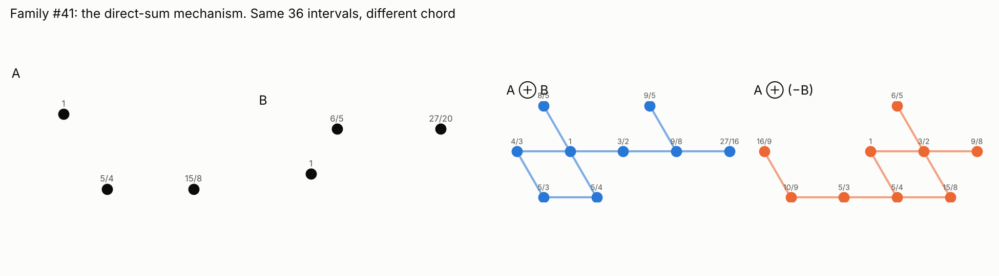
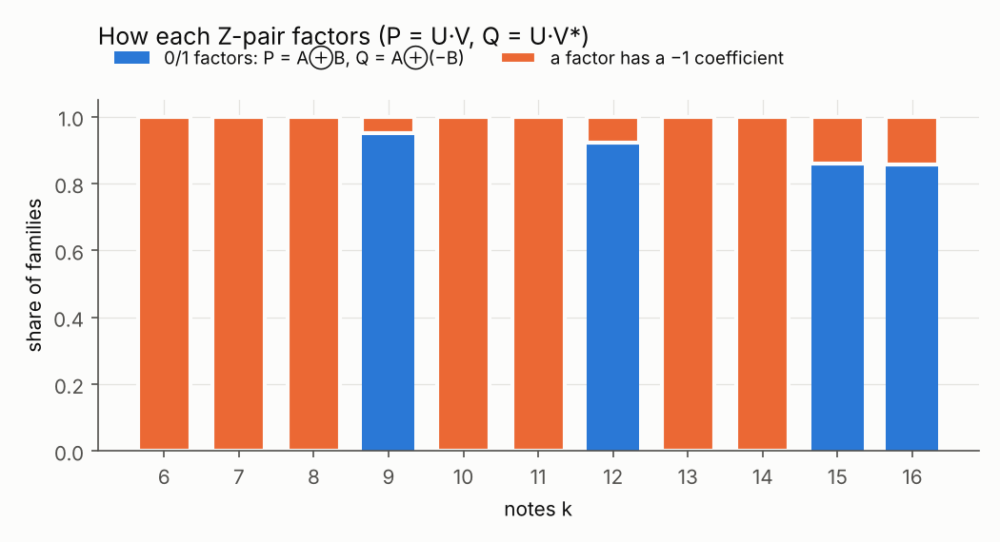

# JI Z-partner search: analysis of `results.tgz`

Scripts are in this folder, tables are in `tables/` and plots are in `figs/`. The raw archive is not committed (42 MB); see [Re-running](#re-running).

## TL;DR

1. **The archive is not a ring-reading search.** It holds one run, `run_5lim_odd123`. That run enumerated every 1–16-note subset of a 35-pitch 5-limit gamut, about 12.6 billion subsets. It looked for **lattice homometry**: sets with the same multiset of interval classes (exact octave-reduced ratios, up to inversion), not the same ring interval vector. So the handoff's ring-size/divisibility questions cannot be answered from this data. The *prime-limit-preserving* question (avenue 1) can, and the answer is a strong yes.
2. **Everything checks out.** All 30,065 families pass every definitional check. An independent brute force reproduces the set-class counts and the exact family lists for every k from 2 to 10.
3. **One mechanism explains everything.** Read each set as a polynomial ∑ x^a y^b, where 3^a·5^b is the note. Every family is then P = U·V with partner Q = U·V*, where V* = V(1/x, 1/y) is V's inversion mirror. In **all** 30,065 families exactly one irreducible factor is flipped. In 87% (26,036) of families both factors are plain note sets, so P = A⊕B is a "chord of chords" and the partner is A⊕(−B). The smallest non-symmetric note set has 3 notes, which is why families spike at k = 9, 12 and 15 (and at 16 = 4×4).
4. **The partner never needs a new prime here.** The partner usually shares most of its notes with the original: 5 of 7, 7 of 9, 12 of 16.
5. **Lattice and ring readings are disjoint so far.** No lattice Z-pair with k ≤ 9 is a ring Z-pair under any choice of 1/1. Tempering into EDOs, however, keeps most of them. In 53-EDO almost all stay Z-pairs, and one k = 6 family becomes the Forte pair **6-Z12 / 6-Z41** in 12-EDO.

## 1. What is in the archive

The upload `…results.tgz.gz` is gzip on top of a `.tgz`, so it needs a double `gunzip`. It unpacks to:

| file | content |
|---|---|
| `run_5lim_odd123/gamut.txt` | 35 ratios. These are **all 5-limit ratios with odd limit ≤ 123** (max odd part of numerator or denominator ≤ 123, i.e. ≤ 81 in practice). In exponents (a, b) of 3^a·5^b: \|b\| ≤ 2, \|a\| ≤ 4, a centrally symmetric hexagon. I inferred this from the name and confirmed it by reconstruction. |
| `run_5lim_odd123/summary.csv` | per k (1–16): subsets, set classes (up to transposition + inversion), Z-families, gamut size |
| `run_5lim_odd123/families.jsonl` | 30,065 lines, one family each: `family`, `notes` (k), `primes` [3,5], `gamut_size`, `members` (each has `lattice`, the exponent vectors translated to lexicographic minimum (0,0) = the full translation+inversion canonical form, and `ratios`), `interval_classes` (the **full multiset** of C(k,2) classes, each min(r, 2/r) ∈ [1, √2]) and `distinct_interval_classes` |
| `run_5lim_odd123.log` | progress log. 3 of 4 cores, pypy, 44.2 min, ~4.8 M subsets/s. |

Inferences worth stating:

* **"Z-related" here means lattice homometry.** Two sets are related when their ± difference vectors in Z² (prime exponents, octaves ignored) agree as multisets, and they are not related by translation (transposition) or negation (otonal/utonal inversion). No ring L is involved.
* **Every family has exactly 2 members.** There are no triples or larger groups.
* **`ratios` is re-rooted.** Each member is transposed so that one of its notes is 1/1. As a result, 37,541 of 60,130 members list notes that are not literally in the gamut. Every one of them fits the gamut after a transposition, so this is a display choice, not an error.

## 2. Validation (`validate.py`, `brute.py`, `compare_brute.py`)

**Checks on all 30,065 families, not a sample:**
* note count and distinctness
* 1/1 present
* fits the gamut up to transposition
* `lattice` equals the canonical form of `ratios`
* both members have identical difference multisets
* `interval_classes` equals the recomputed multiset, and the distinct count matches
* the two members are not transposition/inversion copies
* no class appears in two families
* no two families share a fingerprint (they would need merging)

**Result: 0 errors.**

**Independent recompute.** `brute.py` uses its own numpy implementation. It enumerates every k-subset, hashes the canonical class and the difference fingerprint, and then exactly recomputes every flagged fingerprint.

| k | set classes (brute = summary.csv) | families brute / reported | identical family lists |
|---|---|---|---|
| 2–5 | 60 / 656 / 8,186 / 66,805 | 0 / 0 | ✓ |
| 6 | 415,386 | 7 / 7 | ✓ |
| 7 | 2,017,653 | 8 / 8 | ✓ |
| 8 | 7,976,031 | 10 / 10 | ✓ |
| 9 | 26,243,307 | 2,968 / 2,968 | ✓ |
| 10 | 73,256,474 | 295 / 295 | ✓ |

Caveat: the search is complete *inside the gamut*. A set that has a partner only outside the odd-limit-123 hexagon is not reported. So the counts describe this gamut, not the 5-limit lattice in general.

## 3. Counts and structure (`analyze.py`, `factor.py`, `figures.py` → `tables/by_k.csv`)

| k | families | per 10⁶ classes | 0/1 direct sum | signed factor | partner is a lattice mirror | distinct up to lattice symmetry | mean shared notes |
|---|---|---|---|---|---|---|---|
| 6 | 7 | 16.9 | 0 | 7 | 3 | 5 | 3.0 |
| 7 | 8 | 4.0 | 0 | 8 | 1 | 6 | 5.0 |
| 8 | 10 | 1.3 | 0 | 10 | 1 | 6 | 5.5 |
| 9 | 2,968 | 113.1 | 2,823 | 145 | 58 | 1,914 | 6.3 |
| 10 | 295 | 4.0 | 0 | 295 | 9 | 185 | 6.4 |
| 11 | 25 | 0.14 | 0 | 25 | 0 | 23 | 8.0 |
| 12 | 10,966 | 29.9 | 10,118 | 848 | 87 | 8,062 | 8.6 |
| 13 | 49 | 0.07 | 0 | 49 | 1 | 49 | 9.5 |
| 14 | 498 | 0.46 | 0 | 498 | 7 | 414 | 9.8 |
| 15 | 13,364 | 8.7 | 11,491 | 1,873 | 74 | 10,940 | 11.4 |
| 16 | 1,875 | 0.96 | 1,604 | 271 | 5 | 1,595 | 11.9 |


### The factor law

Homometry in Z² is equivalent to P(x,y)·P(1/x,1/y) = Q(x,y)·Q(1/x,1/y). Laurent polynomials factor uniquely, so Q must be P with some irreducible factors replaced by their mirrors. That is the Rosenblatt–Seymour picture. `factor.py` factors every member with sympy and finds:

* **Exactly one irreducible factor is flipped in every one of the 30,065 families.** In 29,328 families the original has 2 irreducible factors, in 732 it has 3 and in 5 it has 4. The extra factors are kept unchanged.
* The flipped factor V is most often a 3-note set. The top ones are x²+x+y (1,299 families), x³+x+1 (821) and x³+xy+y (808). There are 6,803 distinct flipped factors in all; see `tables/flipped_factor_V.csv`.
* **0/1 direct sums** (`analyze.py` searches for them explicitly) have the form P = A⊕B, meaning every note is a + b with all sums distinct, and Q ≅ A⊕(−B). They need |A|, |B| ≥ 3, because 1- and 2-note sets are inversion-symmetric and give nothing new. That allows only k = 9 (3×3), 12 (3×4), 15 (3×5) and 16 (4×4), which explains the sawtooth in the figure above. For example, family #41 is {1, 5/4, 15/8} ⊕ {1, 6/5, 27/20}:

  

* **Signed-factor families** (4,029) cannot be split into two plain note sets. One factor carries a −1 coefficient. All the k = 6, 7, 8, 10, 11, 13, 14 families are of this type. The most common signed factor is **x³ − x² + 1**, which lies purely on the line of fifths ({1, 27/16} minus 9/8). Flipping it gives x³ − x + 1. It drives families at every k from 7 to 16.
* Of the 4,029 families with no 0/1 split, 2,228 contain a smaller reported Z-pair after deleting 1–3 notes from each member (`contained_family` column). That is descriptive, not causal.



## 4. Prime limit

* Both members of every family are 5-limit, and both use the 5 axis. There are no 3-limit members. Members span 2–5 rows of the 5 axis: 5 rows in 20,457 cases, 4 rows in 8,204.
* This search confines partners to the gamut, so **"primes introduced by the partner" is 0 everywhere**. The handoff's earlier observation that partners "almost always introduce a new prime" was an artifact of the ring reading. In the lattice reading, prime-limit-preserving partners are the norm.
* **Infinitely many exist.** Any two non-symmetric 5-limit note sets A, B with all sums distinct give the pair A⊕B, A⊕(−B), and there are infinitely many such A, B.
* There is no plot of introduced primes, because the distribution is identically 0.

## 5. Lattice families

* **Exact shape.** Each member is its own translation+inversion class, so exact shapes never repeat across families, by construction. Up to the full 12-element symmetry group of the triangular 3/5 lattice, the 30,065 families collapse to 23,199 (column "distinct up to lattice symmetry"). The gamut is not hexagonally symmetric, so orbits are only partly present.
* **Link pattern** (unit 3- or 5-steps, unlabelled graph, WL hash checked with VF2): 12,105 distinct patterns over the 60,130 members. **In 11,985 families (40%) both members have the same link pattern**, most often at k = 9 (84%). The most common patterns are sparse; for example, 9 notes with only 3–4 unit links. See `tables/link_patterns.csv`, and the `link_P` / `link_Q` columns for co-occurrence (10,880 distinct unordered pairs).
* **Partner = lattice mirror of the original** (the lattice analogue of "multiplier equivalence"): 246 families. The three mirror types, with the number of families for each:

  | mirror type | maps | swaps | families |
  |---|---|---|---|
  | `rot0m` | 3 ↦ 3, 5 ↦ 6/5 | **5/4 ↔ 6/5** (major ↔ minor third), fifths fixed | 149 |
  | `rot1m` (with inversion) | 5 fixed | 3/2 ↔ 5/3 | 56 |
  | `rot2m` | 15/8 fixed | 3 ↔ 5 | 36 |

  In 5 more families the original has 3-fold symmetry, so all three mirrors apply. These partners are still genuine, since only transposition and inversion count as trivial. Musically they are the major/minor-swap partners.
* **Shared notes.** After the best transposition or inversion, the partner keeps 3 of 6, 5 of 7, ~6 of 9 and ~12 of 16 notes.

  

All k = 6 and 7 families, rooted on their simplest note:


## 6. Rhythm side and the ring reading

* **Ring reading** (`ring` column, k ≤ 9, 2,993 families): I tried every choice of 1/1 for both members, so k² rootings. In 1,307 families no rooting ever gives the two members the same L. In the other 1,686 some rootings do share L, but the ring interval vectors never match. **No lattice Z-pair with k ≤ 9 is a ring Z-pair.** The two notions are mathematically different (Z² differences vs. Z_L slot differences), and this data does not bridge them.
* **Tempering** (`edo.py`, `tables/edo.csv`): a homomorphism Z² → Z_n preserves difference multisets. So each pair becomes either a collision, a TnI-equivalent pair (the Z-relation is "tempered out"), or a genuine EDO Z-pair.

  | | 12-EDO | 19 | 22 | 31 | 53-EDO |
  |---|---|---|---|---|---|
  | still a Z-pair | 1 | 878 | 3,427 | 1,066 | **29,745** |
  | tempered to TnI-equivalent | 274 | 1,089 | 2,058 | 901 | 320 |
  | collision | 29,790 | 28,098 | 24,580 | 28,098 | 0 |

  In 12-EDO, 81/80 vanishes and the gamut collapses. The one survivor is family #3 (k = 6): {1 10/9 6/5 32/25 128/75 16/9} ↔ {25/24 10/9 6/5 5/4 8/5 16/9}. It tempers to the **Forte pair 6-Z12 [012467] / 6-Z41 [012368]**, interval vector ⟨332232⟩. The 4-note all-interval pair on 8 cannot occur here, because there are no lattice families below k = 6.

## 7. Musically promising pairs (`tables/shortlist_k6_9.csv`)

These are ranked by mean Tenney height of the shared interval content, simplest first:

| # | k | original | partner | shared |
|---|---|---|---|---|
| 41 | 9 | 1 16/15 10/9 9/8 6/5 4/3 3/2 5/3 16/9 | 1 10/9 9/8 6/5 5/4 3/2 5/3 16/9 15/8 | 7 (swap 16/15 4/3 → 5/4 15/8) |
| 242 | 9 | 1 25/24 9/8 6/5 5/4 3/2 8/5 5/3 15/8 | 1 25/24 5/4 4/3 25/18 3/2 8/5 5/3 15/8 | 7 (mirror-symmetric) |
| 1371 | 9 | 1 10/9 5/4 4/3 3/2 5/3 27/16 9/5 15/8 | 1 10/9 9/8 6/5 5/4 4/3 3/2 27/16 9/5 | 7 |
| 3 | 6 | 1 10/9 6/5 32/25 128/75 16/9 | 25/24 10/9 6/5 5/4 8/5 16/9 | 3 (→ 6-Z12/6-Z41) |
| 8 | 7 | 1 10/9 32/27 45/32 40/27 27/16 16/9 | 1 9/8 32/27 45/32 40/27 27/16 15/8 | 5 (major/minor mirror) |
| 21 | 8 | 1 81/80 27/25 9/8 4/3 36/25 5/3 48/25 | 1 27/25 64/45 36/25 3/2 5/3 16/9 48/25 | 5 |

The k = 9 direct sums are the stand-outs: simple 5-limit nine-note "scales" that differ by exchanging two notes yet have identical 36-interval content.

## 8. Proposed next steps (ranked)

1. **Generate families directly instead of enumerating subsets.** *Highest value, cheap (seconds to minutes).* The factor law says a family is a pair (U, V) with V non-self-mirror, plus the condition that both U·V and U·V* are 0/1. Build every product of small note sets and signed polynomials, then filter by gamut and by 0/1-ness. Test: it must reproduce this run's 30,065 families exactly. After that it scales to larger k, larger gamuts and higher limits without the 2^35 wall.
2. **7-limit (Z³) prime-limit-preserving families.** First validate the generator with a small exhaustive run. The 7-limit odd-limit-27 gamut has 45 notes:

   | k ≤ | subsets | runtime at the run's ~4.8 M subsets/s (3 cores) |
   |---|---|---|
   | 9 | 1.2·10⁹ | ≈ 4 min |
   | 10 | 4.4·10⁹ | ≈ 15 min |
   | 12 | 4.3·10¹⁰ | ≈ 2.5 h |

   Then use the generator. Open questions: does the 3-note-factor dominance persist, and do 7-limit-only families appear at k < 6? (In Z³ there is more room, but the minimal-size theory says probably not.) **I have not run any of these. Tell me which ones to run.**
3. **Classify the signed-factor (sporadic) families.** These are the 7 + 8 + 10 small ones, plus x³ − x² + 1 and its relatives. Find the minimal homometric pairs in Z² and decide whether the k = 6 list is a finite catalogue of shapes. Cheap and theory-heavy.
4. **Map JI families to Forte Z-pairs through tempering.** Which of the 15 hexachord Z-pairs (and the tetrachord/pentachord pairs) have 5-limit realizations, and in which EDOs do the Z-relations survive? 53-EDO keeps almost everything, and 12-EDO kills almost everything. Cheap with the generator.
5. **Lattice mirrors as "multipliers."** 246 partners are reflections, mostly the major ↔ minor swap. Count how many families are explained by GL₂(Z) maps beyond the 12 lattice symmetries, and look at whether the mirror families are musically the dualist ones. Cheap.
6. **Ring-reading divisibility law (the handoff's original avenue 3).** This needs its own search, because this data is lattice-based and the two notions do not overlap (§6). Rings with L ≤ 64 and k ≤ 7, sets containing 0, total about 5·10⁸ subsets: minutes in numpy with fingerprint hashing. L ≤ 120 at k = 8 is about 10¹¹ and needs the theory (Rosenblatt; Amiot's DFT) instead of brute force.
7. **Extend the same gamut to all k ≤ 35.** In Z² the complement of a family is not a family. All 2^35 ≈ 3.4·10¹⁰ subsets would take about 2 h on the same VM, with roughly 400 GB of scratch by the log's own ratio. Low value now that the generator explains the structure.
8. **DFT phase view.** On the torus, P̂ and Q̂ differ exactly by the phase of V̂/V̂*, which is 2·arg V̂. The factor law already answers this. Remaining work: plots only.
9. **Listening and consonance scoring** of the shortlist (Tenney height, harmonic entropy), and A/B-ing the k = 9 direct sums. Cheap. Most useful once (1) gives a larger pool.

## Re-running

```bash
# unpack (archive is gzip-wrapped .tgz); keep data outside the repo
mkdir -p $RUN && gunzip -c results.tgz.gz | tar -x -C $RUN
D=$RUN/run_5lim_odd123
python3 validate.py $D              # all-family checks (~40 s)
python3 brute.py $D 2 3 4 5 6 7 8 9 # independent recompute (~8 min; k=10 ≈ 25 min)
python3 compare_brute.py $D
python3 analyze.py $D               # families.csv, link patterns, ring check (~2 min)
python3 factor.py 3                 # sympy factor classification (~10 min on 3 procs)
python3 figures.py $D               # tables + PNGs
python3 edo.py                      # tempering
```

Dependencies: numpy, pandas, matplotlib, networkx (link-pattern isomorphism) and sympy (factorisation only).
