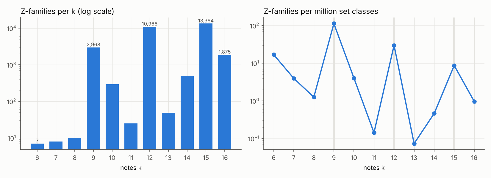
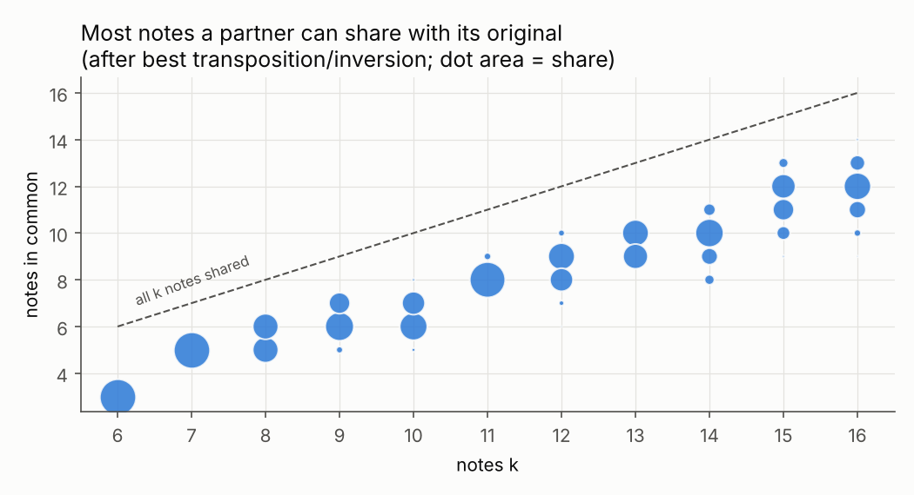
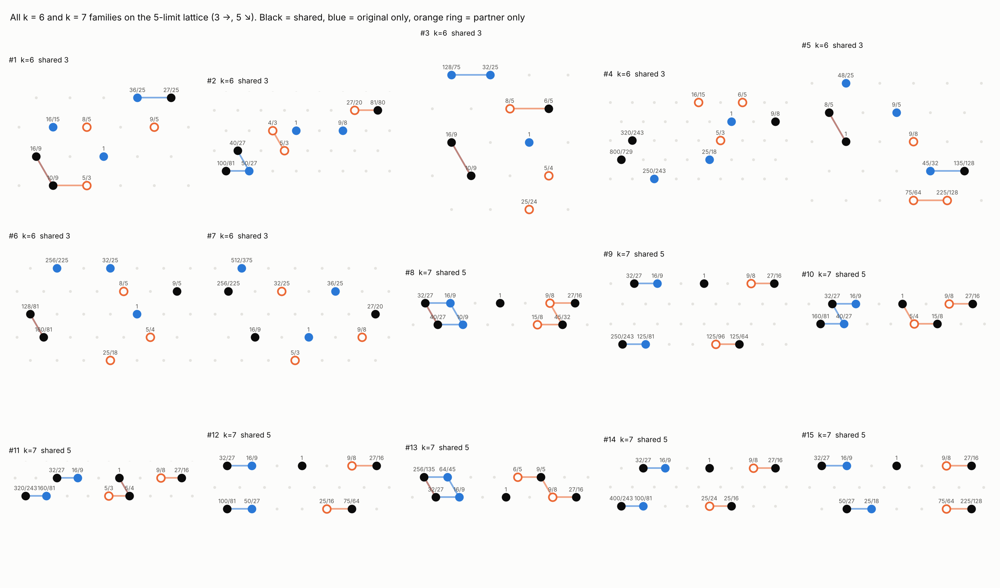

# JI Z-partner search: analysis of `results.tgz`

Scripts are in this folder, tables are in `tables/` and plots are in `figs/`. The raw archive is not committed (42 MB); see [Re-running](#re-running).

**Context.** This is the Google Cloud run from step 31 of *Ratio rhythm: timeline and canon* ("add 7, push to 12 and 16 notes"), here at 5-limit, odd limit ≤ 123, 1–16 notes. It is a **JI-level** search, the first of the three levels in the canon's Canon 6 table. Section 0 shows where the results sit against the canon. The original handoff for this analysis described the linear-ring reading (level 3) and the ring sweep (step 19). Those are separate threads, and this archive holds no data for them.

## TL;DR

1. **A JI-level run.** The archive holds one run, `run_5lim_odd123`. It enumerated every 1–16-note subset of a 35-pitch 5-limit gamut, about 12.6 billion subsets. It looked for JI Z-pairs: sets with the same multiset of octave-reduced intervals (a ratio identified with its inversion). This is **not** the ring interval vector. The ring-size and divisibility questions belong to the separate ring sweep, and this data can't answer them (section 6).
2. **Everything checks out.** All 30,065 families pass every definitional check. An independent brute force reproduces the set-class counts and the exact family lists for every k from 2 to 10. Restricted to odd limit ≤ 75, the families reproduce the canon's earlier odd-limit-75 counts exactly.
3. **One mechanism explains everything, sporadic families included.** Read each set as a polynomial ∑ x^a y^b, where 3^a·5^b is the note. Every family is then P = U·V with partner Q = U·V*, where V* = V(1/x, 1/y) is V's inversion mirror. In **all** 30,065 families exactly one irreducible factor is flipped. In 87% (26,036) of families both factors are plain note sets, so P = A⊕B is a "chord of chords" and the partner is A⊕(−B). This is the canon's A + B construction, and it accounts for the spikes at 9, 12, 15 and 16. The remaining 13% (the canon's "sporadic" families) are the same law with one factor carrying a −1 coefficient.
4. **The canon's open question on 15, 16 and 13 notes is answered.** Families spike at 15 notes (13,364) and stay high at 16 (1,875), while 13 notes stays near zero (49). Partners stay in the 5-limit and keep most notes: 5 of 7, 7 of 9, 12 of 16.
5. **The canon's levels are confirmed.** No JI pair with 9 or fewer notes is a linear-ring pair under any choice of 1/1, which fits "linear-ring pairs are a voicing-level relation". Tempering into EDOs, however, keeps most of them. In 53-EDO almost all stay Z-pairs, and one k = 6 family becomes the Forte pair **6-Z12 / 6-Z41** in 12-EDO.

## 0. Against the canon

**Already established in the canon** (Canon 6, "The JI-level search"; pitfalls). This run confirms each of these at a larger scale:
* the A + B construction (Rosenblatt and Seymour) and its sizes 9, 12, 15 and 16;
* no JI pairs below 6 notes;
* depth over breadth: stacked 3s and 5s, not more primes;
* short fingerprints give chance matches. The log's candidate counts exceed the exact family counts at k = 10, 11, 12, 15 and 16, for example 92 candidates against 25 families at k = 11.

**Consistency with the earlier odd-limit-75 search** (`subgamut.py 75`). Family counts for odd limit ≤ 75 (29 notes), counting families whose members both fit that gamut:

| notes | 6 | 7 | 8 | 9 | 10 | 11 | 12 | 13 | 14 | 15 | 16 |
|---|---|---|---|---|---|---|---|---|---|---|---|
| canon, odd-limit 75 | 5 | 1 | 4 | 1,108 | 110 | 0 | 2,539 | – | – | – | – |
| this run, restricted to odd-limit 75 | 5 | 1 | 4 | 1,108 | 110 | 0 | 2,539 | 0 | 62 | 1,684 | 110 |
| this run, odd-limit 123 | 7 | 8 | 10 | 2,968 | 295 | 25 | 10,966 | 49 | 498 | 13,364 | 1,875 |

The first seven columns agree exactly. The last four extend the odd-limit-75 counts to 13–16 notes.

**Open items from the canon's checklist:**

| canon item | status after this run |
|---|---|
| Do 15 and 16 notes spike and 13 stay near zero? | **Yes.** 8.7 and 1.0 families per million set classes at 15 and 16, against 0.07 at 13 (section 3). |
| Why do the smallest JI pairs have every interval distinct? Classify the sporadic families. | **Partly.** All 7 six-note pairs have 15 distinct intervals out of 15. That stops at 7 notes, where the average is 16 of 21, so it is specific to size 6. Sporadic families follow the factor law with a signed factor (section 3). Cataloguing the signed factors is the remaining step. |
| A canonical form for shapes | **Candidate.** For 5-limit, a family canonicalized under the 12 symmetries of the triangular 3/5 lattice (including the 3 ↔ 5 swap): 30,065 families give 23,199 shapes (section 5). For 7-limit, use permutations of the prime axes in the same way. |
| Is the 13-odd-limit diamond Z-free at every size? | Not addressed: this gamut is 5-limit only. |
| Add the targeted search to the Spectrum lens, reporting log/linear holds | Supporting data: the EDO table (section 6) gives the log-ring survival rates, and linear-ring survival is 0 for 9 or fewer notes. |

## 1. What is in the archive

The upload `…results.tgz.gz` is gzip on top of a `.tgz`, so it needs a double `gunzip`. It unpacks to:

| file | content |
|---|---|
| `run_5lim_odd123/gamut.txt` | 35 ratios. These are **all 5-limit ratios with odd limit ≤ 123** (max odd part of numerator or denominator ≤ 123, i.e. ≤ 81 in practice). In exponents (a, b) of 3^a·5^b: \|b\| ≤ 2, \|a\| ≤ 4, a centrally symmetric hexagon. I inferred this from the name and confirmed it by reconstruction. |
| `run_5lim_odd123/summary.csv` | per k (1–16): subsets, set classes (up to transposition + inversion), Z-families, gamut size |
| `run_5lim_odd123/families.jsonl` | 30,065 lines, one family each: `family`, `notes` (k), `primes` [3,5], `gamut_size`, `members` (each has `lattice`, the exponent vectors translated to lexicographic minimum (0,0) = the full translation+inversion canonical form, and `ratios`), `interval_classes` (the **full multiset** of C(k,2) classes, each min(r, 2/r) ∈ [1, √2]) and `distinct_interval_classes` |
| `run_5lim_odd123.log` | progress log. 3 of 4 cores, pypy, 44.2 min, ~4.8 M subsets/s. |

Inferences worth stating:

* **"Z-related" here means the JI level (lattice homometry).** Two sets are related when their ± difference vectors in Z² (prime exponents, octaves ignored) agree as multisets, and they are not related by translation (transposition) or negation (otonal/utonal inversion). No ring L is involved.
* **Every family has exactly 2 members.** There are no triples or larger groups.
* **`ratios` is re-rooted.** Each member is transposed so that one of its notes is 1/1. As a result, 37,541 of 60,130 members list notes that are not literally in the gamut. Every one of them fits the gamut after a transposition, so this is a display choice, not an error.

## 2. Validation (`validate.py`, `brute.py`, `compare_brute.py`)

**Checks on all 30,065 families, not a sample:**
* note count and distinctness
* 1/1 present
* fits the gamut up to transposition
* `lattice` equals the canonical form of `ratios`
* both members have identical difference multisets
* `interval_classes` equals the recomputed multiset, and the distinct count matches
* the two members are not transposition/inversion copies
* no class appears in two families
* no two families share a fingerprint (they would need merging)

**Result: 0 errors.**

**Independent recompute.** `brute.py` uses its own numpy implementation. It enumerates every k-subset, hashes the canonical class and the difference fingerprint, and then exactly recomputes every flagged fingerprint.

| k | set classes (brute = summary.csv) | families brute / reported | identical family lists |
|---|---|---|---|
| 2–5 | 60 / 656 / 8,186 / 66,805 | 0 / 0 | ✓ |
| 6 | 415,386 | 7 / 7 | ✓ |
| 7 | 2,017,653 | 8 / 8 | ✓ |
| 8 | 7,976,031 | 10 / 10 | ✓ |
| 9 | 26,243,307 | 2,968 / 2,968 | ✓ |
| 10 | 73,256,474 | 295 / 295 | ✓ |

Caveat: the search is complete *inside the gamut*. A set that has a partner only outside the odd-limit-123 hexagon is not reported. So the counts describe this gamut, not the 5-limit lattice in general.

## 3. Counts and structure (`analyze.py`, `factor.py`, `figures.py` → `tables/by_k.csv`)

| k | families | per 10⁶ classes | 0/1 direct sum | signed factor | partner is a lattice mirror | distinct up to lattice symmetry | mean shared notes |
|---|---|---|---|---|---|---|---|
| 6 | 7 | 16.9 | 0 | 7 | 3 | 5 | 3.0 |
| 7 | 8 | 4.0 | 0 | 8 | 1 | 6 | 5.0 |
| 8 | 10 | 1.3 | 0 | 10 | 1 | 6 | 5.5 |
| 9 | 2,968 | 113.1 | 2,823 | 145 | 58 | 1,914 | 6.3 |
| 10 | 295 | 4.0 | 0 | 295 | 9 | 185 | 6.4 |
| 11 | 25 | 0.14 | 0 | 25 | 0 | 23 | 8.0 |
| 12 | 10,966 | 29.9 | 10,118 | 848 | 87 | 8,062 | 8.6 |
| 13 | 49 | 0.07 | 0 | 49 | 1 | 49 | 9.5 |
| 14 | 498 | 0.46 | 0 | 498 | 7 | 414 | 9.8 |
| 15 | 13,364 | 8.7 | 11,491 | 1,873 | 74 | 10,940 | 11.4 |
| 16 | 1,875 | 0.96 | 1,604 | 271 | 5 | 1,595 | 11.9 |



### The factor law

Homometry in Z² is equivalent to P(x,y)·P(1/x,1/y) = Q(x,y)·Q(1/x,1/y). Laurent polynomials factor uniquely, so Q must be P with some irreducible factors replaced by their mirrors. That is the Rosenblatt–Seymour picture. `factor.py` factors every member with sympy and finds:

* **Exactly one irreducible factor is flipped in every one of the 30,065 families.** In 29,328 families the original has 2 irreducible factors, in 732 it has 3 and in 5 it has 4. The extra factors are kept unchanged.
* The flipped factor V is most often a 3-note set. The top ones are x²+x+y (1,299 families), x³+x+1 (821) and x³+xy+y (808). There are 6,803 distinct flipped factors in all; see `tables/flipped_factor_V.csv`.
* **0/1 direct sums** (`analyze.py` searches for them explicitly) have the form P = A⊕B, meaning every note is a + b with all sums distinct, and Q ≅ A⊕(−B). They need |A|, |B| ≥ 3, because 1- and 2-note sets are inversion-symmetric and give nothing new. That allows only k = 9 (3×3), 12 (3×4), 15 (3×5) and 16 (4×4), which explains the sawtooth in the figure above. For example, family #41 is {1, 5/4, 15/8} ⊕ {1, 6/5, 27/20}:

  

* **Signed-factor families** (4,029; the canon's "sporadic" families 892 at sizes A + B cannot build, plus 3,137 at 9, 12, 15 and 16) cannot be split into two plain note sets. One factor carries a −1 coefficient. Every family at 6, 7, 8, 10, 11, 13 and 14 notes is of this type, as the canon's pitfall table predicts. The most common signed factor is **x³ − x² + 1**, which lies purely on the line of fifths ({1, 27/16} minus 9/8). Flipping it gives x³ − x + 1. It drives families at every k from 7 to 16.
* Of the 4,029 families with no 0/1 split, 2,228 contain a smaller reported Z-pair after deleting 1–3 notes from each member (`contained_family` column). That is descriptive, not causal.


## 4. Prime limit

* Both members of every family are 5-limit, and both use the 5 axis. There are no 3-limit members. Members span 2–5 rows of the 5 axis: 5 rows in 20,457 cases, 4 rows in 8,204.
* This search confines partners to the gamut, so **"primes introduced by the partner" is 0 everywhere**. The handoff's examples of partners that add a prime, such as 1/1 9/8 3/2 15/8 ↔ 1/1 9/8 11/8 3/2, have 4 or 5 notes. That is below the JI minimum of 6, so they must be linear-ring (voicing-level) pairs, and the observation belongs to that level. At the JI level, partners that keep the prime limit are the norm.
* **Infinitely many exist.** Any two non-symmetric 5-limit note sets A, B with all sums distinct give the pair A⊕B, A⊕(−B), and there are infinitely many such A, B.
* There is no plot of introduced primes, because the distribution is identically 0.

## 5. Lattice families

* **Exact shape.** Each member is its own translation+inversion class, so exact shapes never repeat across families, by construction. Up to the full 12-element symmetry group of the triangular 3/5 lattice, the 30,065 families collapse to 23,199 (column "distinct up to lattice symmetry"). The gamut is not hexagonally symmetric, so orbits are only partly present.
* **Link pattern** (unit 3- or 5-steps, unlabelled graph, WL hash checked with VF2): 12,105 distinct patterns over the 60,130 members. **In 11,985 families (40%) both members have the same link pattern**, most often at k = 9 (84%). The most common patterns are sparse; for example, 9 notes with only 3–4 unit links. See `tables/link_patterns.csv`, and the `link_P` / `link_Q` columns for co-occurrence (10,880 distinct unordered pairs).
* **Partner = lattice mirror of the original** (the lattice analogue of "multiplier equivalence"): 246 families. The three mirror types, with the number of families for each:

  | mirror type | maps | swaps | families |
  |---|---|---|---|
  | `rot0m` | 3 ↦ 3, 5 ↦ 6/5 | **5/4 ↔ 6/5** (major ↔ minor third), fifths fixed | 149 |
  | `rot1m` (with inversion) | 5 fixed | 3/2 ↔ 5/3 | 56 |
  | `rot2m` | 15/8 fixed | 3 ↔ 5 | 36 |

  In 5 more families the original has 3-fold symmetry, so all three mirrors apply. These partners are still genuine, since only transposition and inversion count as trivial. Musically they are the major/minor-swap partners.
* **Shared notes.** After the best transposition or inversion, the partner keeps 3 of 6, 5 of 7, ~6 of 9 and ~12 of 16 notes.

  

All k = 6 and 7 families, rooted on their simplest note:



## 6. Rhythm side and the ring reading

* **Linear ring, the canon's level 3** (`ring` column, k ≤ 9, 2,993 families): I tried every choice of 1/1 for both members, so k² rootings. In 1,307 families no rooting ever gives the two members the same L. In the other 1,686 some rootings do share L, but the ring interval vectors never match. **No lattice Z-pair with k ≤ 9 is a ring Z-pair.** The two notions are mathematically different (Z² differences vs. Z_L slot differences, the canon's difference tones). This is consistent with the canon: JI pairs are shared by every re-rooting, and linear-ring pairs belong to one voicing.
* **Log ring, the canon's level 2: tempering** (`edo.py`, `tables/edo.csv`). The canon says log-ring pairs are "usually inherited" from the JI level, and this puts numbers on it. a homomorphism Z² → Z_n preserves difference multisets. So each pair becomes either a collision, a TnI-equivalent pair (the Z-relation is "tempered out"), or a genuine EDO Z-pair.

  | | 12-EDO | 19 | 22 | 31 | 53-EDO |
  |---|---|---|---|---|---|
  | still a Z-pair | 1 | 878 | 3,427 | 1,066 | **29,745** |
  | tempered to TnI-equivalent | 274 | 1,089 | 2,058 | 901 | 320 |
  | collision | 29,790 | 28,098 | 24,580 | 28,098 | 0 |

  In 12-EDO, 81/80 vanishes and the gamut collapses. The one survivor is family #3 (k = 6): {1 10/9 6/5 32/25 128/75 16/9} ↔ {25/24 10/9 6/5 5/4 8/5 16/9}. It tempers to the **Forte pair 6-Z12 [012467] / 6-Z41 [012368]**, interval vector ⟨332232⟩. The 4-note all-interval pairs on 8 and 13 can't occur here, because there are no JI families below 6 notes. Those are pure ring phenomena.
* **The ring-divisibility law** (3 to 6 onsets on rings 6–61) is a property of Z_L, not of JI sets. It needs its own ring sweep; see proposal 5.

## 7. Musically promising pairs (`tables/shortlist_k6_9.csv`)

These are ranked by mean Tenney height of the shared interval content, simplest first:

| # | k | original | partner | shared |
|---|---|---|---|---|
| 41 | 9 | 1 16/15 10/9 9/8 6/5 4/3 3/2 5/3 16/9 | 1 10/9 9/8 6/5 5/4 3/2 5/3 16/9 15/8 | 7 (swap 16/15 4/3 → 5/4 15/8) |
| 242 | 9 | 1 25/24 9/8 6/5 5/4 3/2 8/5 5/3 15/8 | 1 25/24 5/4 4/3 25/18 3/2 8/5 5/3 15/8 | 7 (mirror-symmetric) |
| 1371 | 9 | 1 10/9 5/4 4/3 3/2 5/3 27/16 9/5 15/8 | 1 10/9 9/8 6/5 5/4 4/3 3/2 27/16 9/5 | 7 |
| 3 | 6 | 1 10/9 6/5 32/25 128/75 16/9 | 25/24 10/9 6/5 5/4 8/5 16/9 | 3 (→ 6-Z12/6-Z41) |
| 8 | 7 | 1 10/9 32/27 45/32 40/27 27/16 16/9 | 1 9/8 32/27 45/32 40/27 27/16 15/8 | 5 (major/minor mirror) |
| 21 | 8 | 1 81/80 27/25 9/8 4/3 36/25 5/3 48/25 | 1 27/25 64/45 36/25 3/2 5/3 16/9 48/25 | 5 |

The k = 9 direct sums are the stand-outs: simple 5-limit nine-note "scales" that differ by exchanging two notes yet have identical 36-interval content.

## 8. Proposed next steps (ranked)

Re-ranked against the canon. `ji_zsets.py` already has the A + B construction and the targeted search, so those are not proposed again.

1. **Catalogue and generate the sporadic families.** *Highest value, cheap.* The new piece is the signed factors: x³−x²+1 and its relatives (`tables/flipped_factor_V.csv`). Generate families as U·V and U·V* over small 0/1 sets U and small signed V, keeping pairs where both products are 0/1. This covers every size, including 6, 7, 8, 10, 11, 13 and 14, which A + B can't build. Test: it must reproduce all 30,065 families. It then answers "why are the smallest pairs all-distinct?" and gives the shape catalogue. Seconds to minutes.
2. **Shape canonical form as a catalogue key.** Adopt the lattice-symmetry key (section 5) for 5-limit, extend it to prime-axis permutations for 7-limit, and re-count shapes in the earlier 7-limit runs. This tests the canon's "adding 7 gave no new shape" claim. Cheap.
3. **7-limit exhaustive run to validate the generator.** The 7-limit odd-limit-27 gamut has 45 notes:

   | k ≤ | subsets | runtime at the run's ~4.8 M subsets/s (3 cores) |
   |---|---|---|
   | 9 | 1.2·10⁹ | ≈ 4 min |
   | 10 | 4.4·10⁹ | ≈ 15 min |
   | 12 | 4.3·10¹⁰ | ≈ 2.5 h |

   **None of these has been run. Tell me which to run.**
4. **Targeted search in the Spectrum lens** (canon app item). Use the factor view to explain each partner: report the flipped factor, whether it is an A + B pair, and whether the pair survives the current log ring (EDO table) and the linear ring (so far, never). Implementation work, no new search.
5. **Ring-divisibility law (Canon 6 open theory question).** This is a separate thread from this archive. It needs a fresh ring sweep. Rings with L ≤ 64 and up to 7 onsets, sets containing 0, total about 5·10⁸ subsets: minutes in numpy with fingerprint hashing. Pair it with theory, since homometry on Z_L is equal DFT magnitudes (Rosenblatt; Amiot). Larger rings, such as L ≤ 120 with 8 onsets (about 10¹¹ subsets), need the theory rather than brute force.
6. **Map JI families to Forte Z-pairs through tempering.** Which hexachord Z-pairs have 5-limit realizations, and in which EDOs do they survive? Cheap with the generator.
7. **Lattice mirrors.** 246 partners are reflections, mostly the major ↔ minor swap. Count GL₂(Z) relations beyond the 12 lattice symmetries. Cheap.
8. **Listening and consonance scoring** of the shortlist, with the see-and-hear view in the lab. Cheap.
9. **All k ≤ 35 on this gamut.** About 2 h and roughly 400 GB of scratch. Low value now that the factor law explains the structure.

## Re-running

```bash
# unpack (archive is gzip-wrapped .tgz); keep data outside the repo
mkdir -p $RUN && gunzip -c results.tgz.gz | tar -x -C $RUN
D=$RUN/run_5lim_odd123
python3 validate.py $D              # all-family checks (~40 s)
python3 brute.py $D 2 3 4 5 6 7 8 9 # independent recompute (~8 min; k=10 ≈ 25 min)
python3 compare_brute.py $D
python3 analyze.py $D               # families.csv, link patterns, ring check (~2 min)
python3 factor.py 3                 # sympy factor classification (~10 min on 3 procs)
python3 figures.py $D               # tables + PNGs
python3 edo.py                      # tempering
python3 subgamut.py 75              # consistency with the odd-limit-75 search
```

Dependencies: numpy, pandas, matplotlib, networkx (link-pattern isomorphism) and sympy (factorisation only).
